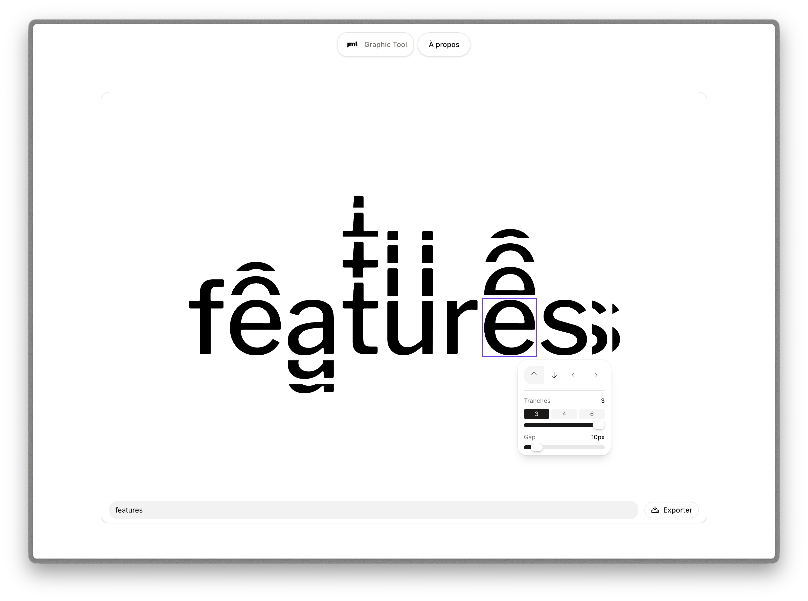

# Graphic Tool JML

Outil de composition typographique directionnelle basé sur la charte graphique JML.  
Développé pour les équipes Grapheine et JML Water Feature Design.

**Version en ligne (déploiement officiel) : [picodesign.fr/jml](https://picodesign.fr/jml)**



---

## Fonctionnement

**1. Saisir un texte** dans le canvas — police Libre Franklin 200 px, rendu vectoriel natif.

**2. Sélectionner une lettre** en cliquant dessus.

**3. Activer une ou plusieurs directions** — ↑ ↓ ← →  
Chaque bouton est un toggle indépendant. Plusieurs directions peuvent être actives simultanément sur la même lettre.

**4. Régler les slices**  
Ajuster le nombre de slices avec le slider (1 → 6). Espacement fixe à 10 px.

**5. Exporter** en SVG vectoriel (Illustrator-ready) ou PNG 300 dpi fond transparent.

---

## Stack

| Couche | Technologie |
|--------|-------------|
| Framework | Next.js 16 — App Router — React 19 |
| Langage | TypeScript |
| Rendu | HTML5 Canvas 2D + OpenType.js |
| État | Zustand |
| UI | shadcn/ui — Tailwind CSS v4 — Radix UI |
| Thème | next-themes (light / dark) |
| Déploiement | Statique — Vercel / intégration site existant |

---

## Démarrage

```bash
npm install
npm run dev
```

---

## Spécifications

| Paramètre | Valeur |
|-----------|--------|
| Police | Libre Franklin Medium 500 |
| Canvas | 1200 × 800 px |
| Directions | Jusqu'à 4 simultanées par lettre |
| Slices | Slider 1 → 6, espacement fixe 10 px |
| Export SVG | Paths vectoriels natifs |
| Export PNG | 300 dpi, fond transparent |
| Navigateurs | Chrome, Safari, Edge — desktop ≥ 1280 px |

---

## Déploiement

> **Application statique** — aucune dépendance serveur, aucune base de données. Tout le rendu s'effectue côté navigateur. L'outil peut être hébergé sur n'importe quel serveur web ou intégré directement dans un site existant.

### Déploiement officiel

L'instance de référence est hébergée par PicoDesign : [picodesign.fr/jml](https://picodesign.fr/jml). C'est la seule version maintenue et mise à jour.

### Vercel (pour démarrer rapidement)

Pour tester ou héberger votre propre copie :

[](https://vercel.com/new/clone?repository-url=https://github.com/picodesign/jml)

Le bouton clone le dépôt dans votre compte GitHub et le déploie sur Vercel : aucune configuration requise, l'outil est servi à la racine. HTTPS inclus.

> **Forfaits** : le forfait Hobby de Vercel est réservé à un usage personnel non commercial, et le dépôt doit se trouver sur un compte GitHub personnel (pas une organisation). Un usage en entreprise relève du forfait Pro.

### Sous-chemin (optionnel)

Pour servir l'outil sous un sous-chemin (ex. `/jml`), définir `NEXT_PUBLIC_BASE_PATH=/jml` **avant** le build.

### Intégration dans un site existant

```bash
npm run build
# génère les fichiers dans .next/
```

Les fichiers produits peuvent être déposés sur n'importe quel hébergement web existant (Apache, Nginx, hébergement mutualisé…) et servis sous un sous-chemin au choix — ex. `jml-elements.com/outil`.

### Local

```bash
npm install && npm run build && npm run start
```

Accessible uniquement depuis le réseau local.

---

## Crédits

| Rôle | Intervenant |
|------|-------------|
| Conception identité visuelle JML | [Grapheine](https://grapheine.com) |
| Développement | Alessandro Capiluppi / [PicoDesign](https://picodesign.fr) |
| Client | [JML Water Feature Design](https://www.jml-elements.com/) |

---

## Licence

© 2026 Alessandro Capiluppi / [PicoDesign](https://picodesign.fr) — tous droits réservés.

Outil conçu pour [Grapheine](https://grapheine.com) et [JML Water Feature Design](https://www.jml-elements.com/), à usage interne. Le code est consultable publiquement, sans autre droit — voir [LICENSE](./LICENSE).

La police Libre Franklin est distribuée sous [SIL OFL 1.1](./public/fonts/OFL.txt).
